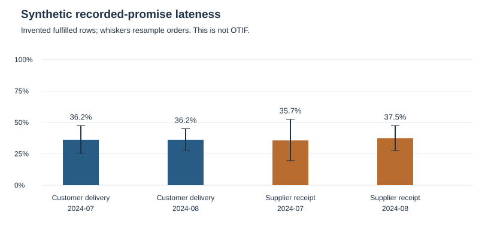

# Synthetic supply and service review

SYNTHETIC: independently invented demonstration, not company results. All records, quantities, dates, policies and counterparties are invented from seed 723091. No company file or company aggregate is read or used to fit the scenario. Outputs contain aggregates only.

| Flow | Month | Rows | Late share | Order-cluster interval | P90 lead days |
|---|---|---:|---:|---|---:|
| Customer delivery | 2024-07 | 80 | 36.2% | 25.0%–47.5% | 14.0 |
| Customer delivery | 2024-08 | 80 | 36.2% | 27.5%–45.0% | 14.0 |
| Supplier receipt | 2024-07 | 42 | 35.7% | 19.6%–52.5% | 32.0 |
| Supplier receipt | 2024-08 | 40 | 37.5% | 27.5%–47.5% | 33.2 |

The interval is a percentile bootstrap over order clusters within each flow/month, with 1200 draws. The statistic remains late fulfilled export rows divided by eligible fulfilled export rows. Repeated rows of an order are resampled together. Intervals describe this invented observed population and do not fix selection bias or establish future service probabilities.

## Inventory and source controls

Opening quantities plus already-negative outflows and positive inflows reconstruct stock through 2024-08-31. Quantities stay separated by SKU, warehouse and unit; the published roll-up is by unit. September activity is excluded. The independently invented current policy reference is dated September 15 and is compared at company/SKU/unit scope for review only. It is not historical policy, a warehouse allocation or an automatic order recommendation. Inventory valuation and working-capital savings are not estimated.

Source-line key collisions are retained and reported, including different lines sharing an order/receipt/item/warehouse key. A deliberately inconsistent return identity is visible instead of being repaired silently. Missing promise dates and receipt-before-order rows are excluded from timing denominators. Recorded promises can have been revised; the data does not identify all requested lines, canceled or zero-delivery orders. No OTIF/fill-rate/causal-improvement claim is made.

12/12 scenario checks pass. Reproduce from the project root with `python -m src.supply_service_demo`. The generator reads method SQL only and writes these public aggregates; event-level generated inputs are not exported.
